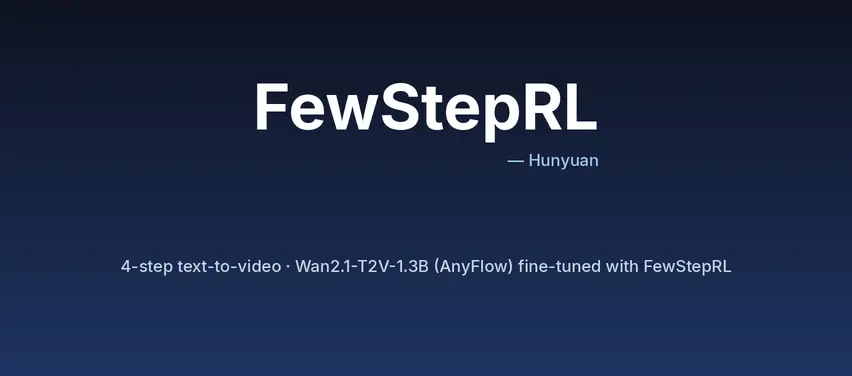
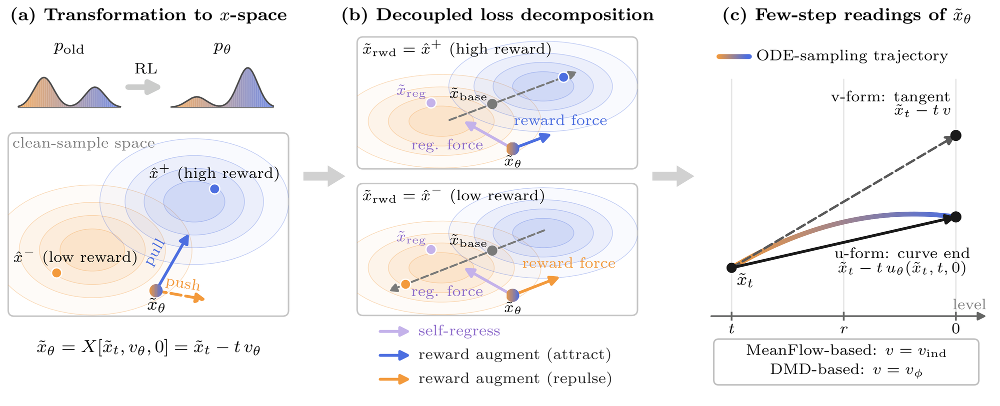
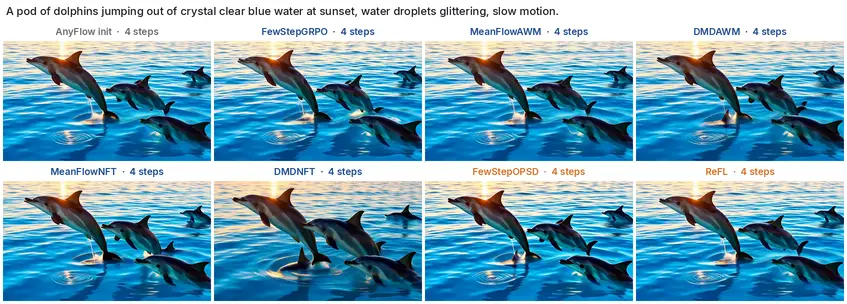

<div align="center">

# FewStepRL <sub><sup>— Hunyuan</sup></sub>

### Fine-tuning Few-step Diffusion Models with Reinforcement Learning

Haitao Lin, Minsi Ren, Yang Li, Xingtong Ge, Zheyuan Hu, Peiyan Hu, Zhiming Ma, Tailin Wu

**Video (Wan2.1-T2V-1.3B) code** · image code: [fewsteprl-sd35](https://github.com/EDAPINENUT/fewsteprl-sd35) · [project page](https://edapinenut.github.io/fewsteprl.page/)

<a href="assets/teaser.mp4"></a>

<sub>4-step text-to-video (81 frames, 480×832, no CFG) from AnyFlow-Wan2.1-T2V-1.3B fine-tuned with the FewStepRL trainers; the label on each clip is its trainer.
Click for the full-resolution mp4; prompts in the <a href="assets/teaser_index.md">teaser index</a>. Each clip is reproduced by
<code>python inference.py scripts/eval/configs/sample_wan.yaml --prompt "…" --override seed=0 mode=meanflow_nft meanflow_nft_path=checkpoints/&lt;name&gt;/checkpoint-250/generator_ema.pt</code>.</sub>

</div>

🔥 **FewStepRL** adapts reinforcement-learning objectives to few-step (flow-map) generators in three phases —
a **transformation** to *x*-space, a **decomposition** of the gradient into self-regression + reward augmentation, and an
**adaptation** of its anchors to an average-velocity model — which yields few-step versions of **FlowGRPO, AWM, DiffusionNFT,
DiffusionOPSD and ReFL** in one modular codebase.

<p align="center"></p>

## 🎬 Same prompt, same noise: AnyFlow init vs. seven RL trainers

<a href="assets/compare_trainers.mp4"></a>

“A pod of dolphins jumping out of crystal clear blue water at sunset, water droplets glittering, slow motion.”, seed 1, 4 steps, no CFG.
Every trainer starts from the same AnyFlow policy and the same reward (HPSv3 general + percentile + VideoAlign MQ + TA). This clip was picked
from 436 clips for a large difference across trainers: in the second half the pod differs (FewStepGRPO and FewStepOPSD add small far-off jumpers,
and DMDNFT's dolphins are larger and closer). The median over the seven trainers of the mean pixel difference to the
AnyFlow clip is 17.3 here, against 7.2 for the median clip, so on typical prompts the clips differ mostly in detail — consistent with the paper,
where VBench overall spans only 0.32 points across the seven trainers (Tab. 8). DMDNFT moves furthest from the initialization: it has the highest
training reward (17.93 vs. 16.54) and also the lowest VBench overall (83.38) and dynamic degree (53.33).

## ⏱️ 4 steps vs. 50 steps

<a href="assets/compare_steps.mp4"></a>

Left: the original Wan2.1-T2V-1.3B with 50 steps and CFG 5.0 (100 network evaluations); right: three FewStepRL trainers
with 4 steps (4 evaluations each), same prompt and seed. All three start from the same 4-step AnyFlow initialization and are ordered
by how far they move from it (mean pixel difference to the AnyFlow clip over 240 clips: MeanFlowAWM 3.4, MeanFlowNFT 11.6, DMDNFT 24.7).
MeanFlowAWM, the best trainer on VBench overall (83.70), stays closest to the initialization; DMDNFT, with the largest training-reward gain
(17.93 vs. 16.54, Tab. 8), keeps the layout but gives brighter, higher-contrast subjects, and the woman in the first clip faces the camera.
The examples were selected from 40 prompts × 6 seeds for a large difference of MeanFlowNFT and DMDNFT from the AnyFlow clip, so they
show it clearly; on average it is smaller. This is an illustration only — the paper does not evaluate the 50-step model.

## 📦 This repository

Reinforcement learning for a **4-step text-to-video flow map**:
[AnyFlow-Wan2.1-T2V-1.3B](https://huggingface.co/nvidia/AnyFlow-Wan2.1-T2V-1.3B-Diffusers)
(480x832, 81 frames). Every experiment starts from the same AnyFlow policy and
trains a LoRA plus the flow map's `delta_embedder` with one RL algorithm on the
same reward combination: HPSv3 general + HPSv3 percentile + VideoAlign MQ +
VideoAlign TA, on the `dataset/wan_dancegrpo` prompts. Evaluation uses the 256
held-out prompts (training rewards) and VBench (held out).

## Experiments

Each name is simultaneously the launcher `scripts/train/<name>.sh`, the config
`scripts/train/configs/<name>.yaml`, and (for the seven main experiments) the
released checkpoint `checkpoints/<name>/` (see
[checkpoints/README.md](checkpoints/README.md) for scores).

| name | trainer key | method | default GPUs |
|---|---|---|---|
| `meanflownft` | `meanflow_nft` | MeanFlowNFT: self-induced anchor with the central-difference S-term, decoupled NFT loss | 32 |
| `dmdnft` | `dmdnft_rl` | DMD-NFT: anchor velocity from an online-trained auxiliary v-predictor | 32 |
| `dmdawm` | `dmdawm_rl` | DMD-AWM: AWM ratio without central difference + aux v-predictor baseline | 48 |
| `fewstepgrpo` | `meanflowgrpo_rl` | MeanFlowGRPO: flow-GRPO ratio on replayed SDE rollout transitions | 32 |
| `meanflowawm` | `meanflowawm_rl` | MeanFlowAWM: advantage-weighted x0 matching with a PPO trust region | 32 |
| `meanflowopsd` | `meanflowopsd_rl` | MeanFlow-OPSD (v-form), reward direction from differentiable HPSv3 | 40 |
| `reflmx` | `meanflowrefl_rl` | the ReFL special case of few-step OPSD (ascent square only, mixed reward) | 48 |
| `nft` | `nft_rl` | S-term ablation of MeanFlowNFT: average velocity used as the instantaneous one, no central difference (no released checkpoint) | 32 |

All trainers live in `fewsteprl/trainers/` with the same file and class names
as the SD3.5 release (`meanflownft.py` holds `MeanFlowNFTTrainer` and
`NFTTrainer`, ...), built on `rl_general_base.py` (rollout, advantages,
decoupled loss, aux v-predictor loop, video evaluation). The OPSD and ReFL
trainers add `opsd_grad_mixin.py` for differentiable video-reward gradients.

## Layout

```
main.py                  training entry point (TRAINER_REGISTRY, --eval-only)
inference.py             sampling entry point (used by scripts/eval)
fewsteprl/               library: config, Wan flow-map model, trainers, video rewards, VBench evaluator
third_party/VideoAlign/  vendored VideoAlign inference code (MIT) for the MQ / TA rewards
dataset/                 wan_dancegrpo prompts (train / 256 test), VBench prompt metadata
scripts/train/           <name>.sh launchers, shared _launcher.sh, configs/<name>.yaml
scripts/eval/            sampling, reward scoring, VBench (see scripts/eval/README.md)
checkpoints/             configs of the released LoRAs (weights: coming soon on Hugging Face)
download_scripts/        download_assets.sh: AnyFlow-Wan, reward models, VBench weights
models/                  (created by download_assets.sh, not tracked)
```

## Setup

```bash
pip install -r requirements.txt               # Python 3.10, CUDA 12.4, torch 2.6
pip install hpsv3==1.0.0 --no-deps
pip install trl==0.12.2 --no-deps
pip install vbench==0.1.5 --no-deps
bash download_scripts/download_assets.sh       # ~82 GB; WITH_VBENCH=0 for training only (~69 GB)
```

The AnyFlow-Wan license restricts the model and derivative weights to
non-commercial use. Every asset location can be overridden with
`FEWSTEPRL_ANYFLOW_WAN_PATH`, `FEWSTEPRL_VIDEOREWARD_PATH`,
`FEWSTEPRL_VIDEOALIGN_PATH`, `VBENCH_CACHE_DIR` and `HF_HOME`; the launchers
check every file before spawning ranks. Training runs offline
(`HF_HUB_OFFLINE=1`, `WANDB_MODE=offline` by default; export
`WANDB_MODE=online` to log to wandb).

## Training

Run the same command on every node, changing only `NODE_RANK`:

```bash
NODE_RANK=0 MASTER_ADDR=10.0.0.1 bash scripts/train/meanflownft.sh 8
NODE_RANK=1 MASTER_ADDR=10.0.0.1 bash scripts/train/meanflownft.sh 8
...

# quick single-node test
NNODES=1 bash scripts/train/dmdawm.sh 8 fewstep_rl.num_epochs=2
```

Each launcher defaults `NNODES` to the released run (4 nodes = 32 GPUs; 5 for
`meanflowopsd`, 6 for `dmdawm` and `reflmx`). Extra arguments are `key=value`
config overrides. `train.batch_size * world_size` must be divisible by
`fewstep_rl.num_image_per_prompt` (2 x 32 = 64 = 4 prompts x 16 videos), which
the launcher checks. Sharding is HSDP (shard within a node, replicate across
nodes). Outputs go to `outputs/<name>/<timestamp>/checkpoint-<epoch>/`;
`generator_ema.pt` there is what `scripts/eval` consumes. Resume with
`train.resume_from=<checkpoint dir>`; `EVAL_ONLY=1` runs the in-training
evaluation once on such a full checkpoint directory.

## Evaluation

```bash
bash scripts/eval/eval_ckpt.sh meanflownft 8                  # training rewards on 256 test prompts
VBENCH=1 VBENCH_PYTHON=/path/to/vbench-scoring/bin/python \
    bash scripts/eval/eval_ckpt.sh meanflownft 8              # + VBench
bash scripts/eval/eval_all.sh 8                               # base + all experiments -> outputs/eval/summary.md
```

Environments, scorer download links, protocol and caveats:
[scripts/eval/README.md](scripts/eval/README.md).

## Acknowledgements

Built on [AnyFlow](https://github.com/NVlabs/AnyFlow),
[MeanFlow](https://github.com/Gsunshine/meanflow),
[DiffusionNFT](https://github.com/NVlabs/DiffusionNFT),
[VideoAlign](https://github.com/ModelTC/VideoAlign),
[HPSv3](https://github.com/MizzenAI/HPSv3),
[VBench](https://github.com/Vchitect/VBench),
[Diffusers](https://github.com/huggingface/diffusers) and
[PEFT](https://github.com/huggingface/peft).

## License

See [LICENSE](LICENSE). AnyFlow-Wan and the reward models are under their own
licenses.
